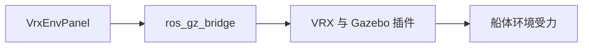

# 功能包架构

本包提供 RViz 插件，不提供独立 ROS 节点。

面板负责参数输入和发布；风、水流、波浪和光照的仿真计算由 Gazebo 插件负责。

- `VrxEnvPanel`：发布环境控制参数。
- `DynamicShipPanel`：发布目标船配置。
- `StormFieldPanel` 和 `StormPointTool`：配置风暴场；单击使用默认漂移方向，拖拽指定方向。
- `DynamicShipTool`：共用的单击／拖拽交互，`StormPointTool` 仅指定风暴名称、话题和快捷键；动态船面板选择实际仿真或虚拟类型，共用一个添加工具。
- `RadarPanel`：通过参数服务和控制服务配置 `/radar_control_node`。
