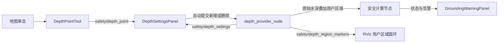

# 功能包架构

`GroundingWarningPanel` 只订阅状态和告警。独立 `DepthSettingsPanel` 只有半径、水深输入及删除操作，
不提供添加、同步确认或坐标输入按钮。`DepthPointTool` 每次单击选择一个区域中心，随后自动退出到默认地图工具。

每次取点会记录当时的半径和水深，操作排队后逐个自动保存并应用。
列表以服务端已应用的区域为准，不显示原始预设或保存失败的区域。
删除操作提交剩余区域列表，从原始水深重新叠加剩余区域，恢复已删除区域下方的原始数据。

区域圆环在设置保存成功后随状态一起发布，使用可靠的保留消息。只绘制用户区域；整批替换同一个 Marker，删除时不会残留旧圆环。无需新增独立节点。
