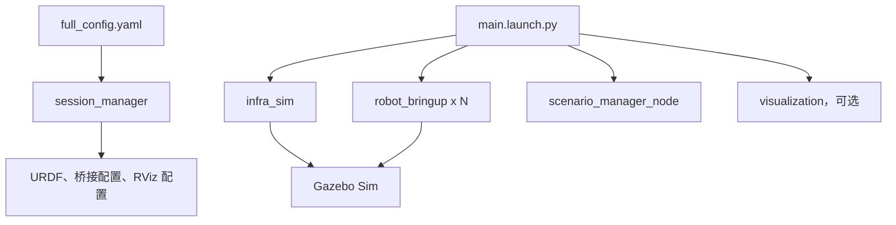

# 功能包架构

`launch/main.launch.py` 是完整仿真的主入口。

启动顺序：

1. `session_manager` 读取配置并生成会话文件。
2. `infra_sim` 启动 Gazebo 世界和全局桥接。
3. `robot_bringup` 按船生成实体、状态发布器和传感器桥接。
4. 主入口按配置启动场景、真值、毫米波和海事雷达后处理组件。

## 可选船载附件

`robot_N.vessel_devices.enabled` 控制本地 `wamv_no_battery.urdf.xacro` 中的灯和可放倒桅杆，默认十二个随动桅杆灯加四个固定船顶角灯、原 CAD 两倍桅杆尺寸。`session_manager` 校验并生成每船附件配置（包括新增灯红/绿颜色的部分覆盖和 `roof_lights_enabled`），`infra_sim` 提供插件路径。模型、代码、消息和服务都在 `usv_vessel_devices` 内，由 Gazebo 插件直接提供 ROS 接口，不增加设备桥接，不改推进器和传感器挂载。

## 可选动态目标船队

`dynamic_ship_manager` 从安装目录加载 13 项船型目录。新 10 款完整克隆原生 SDF，使用仅作用于
所属模型的 `FleetBuoyancy`；不修改世界级浮力。RViz 通过目录/V2 配置服务选型并确认，管理器
继续负责创建/删除场景确认与实测帧门控。
