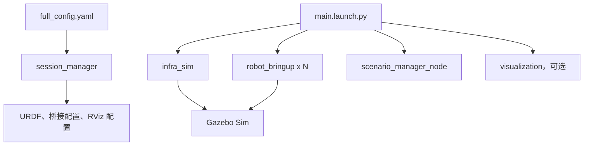

# 功能包架构

`launch/main.launch.py` 是完整仿真的主入口。



启动顺序：

1. `session_manager` 读取配置并生成会话文件。
2. `infra_sim` 启动 Gazebo 世界和全局桥接。
3. `robot_bringup` 按船生成实体、状态发布器和传感器桥接。
4. 主入口按配置启动场景、真值、毫米波和海事雷达后处理组件。

## CCS BT v2 入口

`CCS_Certified_Simulation_Environment.launch.py` 是当前 CCS 入口，默认启用 v2：

```text
CCS → nav2_sim_three_vision_mmwave_bringup → nav2_thruster_bringup → usv_autonomy
 │                                                               ├─ task_tree / mission
 └─ three_vision_one_mmwave.rviz → 运行时配置 → USV BT v2 面板       ├─ regular_safety / motion_gate
                                                                 └─ simulation_controls（CCS 测试）
```

原 Navigation 2、G 工具和保存布局保留，增量附加 USV BT v2 页签。两种面板均通过 ManageMission
创建和交接任务；原 G 直接创建受管任务，新增 U 工具只编辑草稿。最终运动经身份化命令和独立门控
进入 managed_output 桥。`autonomy_v2` 与 `enable_autonomy_test_controls` 逐层显式传递，不另起重复导航/PID 链。
